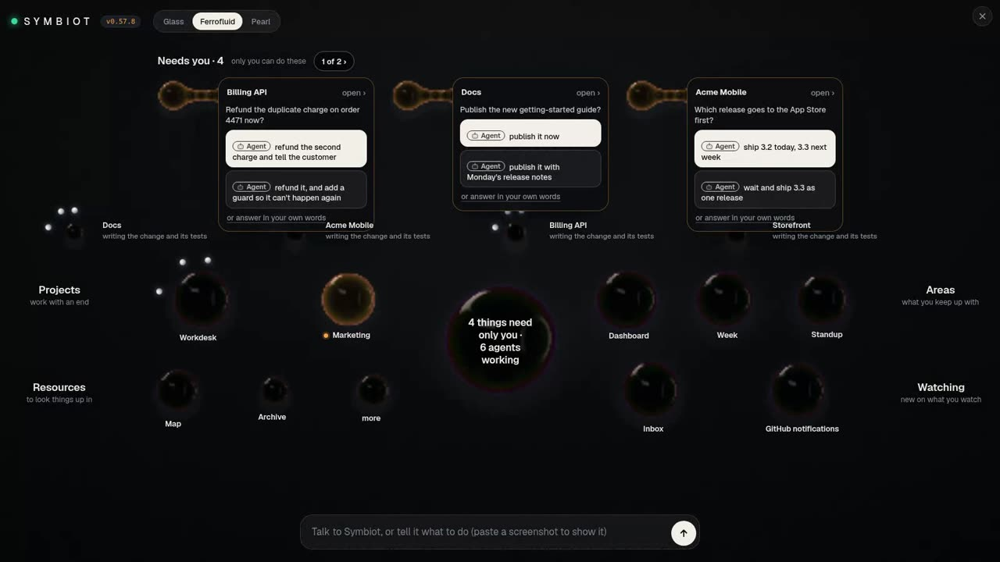

# Symbiot

Your week, written from your real work.

<!-- Tutorial video: put the link and its thumbnail here once it's recorded, and remove the line below. -->
**▶ Tutorial video: coming soon.**

Symbiot is an assistant that runs on your own computer. It reads your **local git**
(what you committed, merged and left uncommitted) and writes up your week, your
standup and what's still on your plate, from what actually happened rather than
what you remember on a Friday afternoon. Around that is **one assistant** you reach
from every page (Dashboard, Workdesk, Reports and the rest): it hands tasks to your
coding agent, brings the finished work back for your OK, and keeps track of what
comes in. The end goal is simple: your time goes on what only you can do (a
decision, a sign-in, a yes) and Symbiot keeps up with the rest.



_Home, from the demo clip (demo projects): what needs you sits in a band across the
top, and every page is an orb below it._

## Install

You need [Node.js](https://nodejs.org) 18 or newer, and an AI for Symbiot to think
with. The easiest is your Claude subscription (Pro or Max) through
[Claude Code](https://claude.com/claude-code): no API key, nothing extra to pay.
Setup can install Claude Code for you. An Anthropic, OpenAI or Gemini API key works
too, or a free local model through [Ollama](https://ollama.com).

```bash
npm install -g symbiot
```

On a desktop, Symbiot opens straight into **setup** when the install finishes. On
Linux it also adds itself to your app menu, and on Windows to the Start menu and
your desktop, so next time you can open it from there. From a terminal:

```bash
symbiot open        # start Symbiot in the background and open its window
symbiot --version   # which Symbiot you have
```

Would rather not install anything yet? `npx symbiot week` writes up your last 7
days straight from the terminal. It uses Claude Code if you're signed in to it;
otherwise `npx symbiot login` connects an AI first.

Installers for Windows, Mac and Linux, and the Android app, are on
[symbiot.co.za](https://symbiot.co.za). These steps were checked on Symbiot 0.81.0.

## Your first 10 minutes

Setup walks you through this in order. Do these three things now and leave the
rest for later.

1. **Pick your AI.** On **Your AI**, if Claude Code is already signed in, it's
   ticked and you just press Continue. If not, press **Install Claude Code** and then
   **Sign in with Claude**, or paste an API key, or choose a local model.
   (From a terminal: `symbiot login`.)
2. **Add your folders.** On **Your work**, Symbiot searches your home folder for
   projects and lists what it found. If one is missing, add the folder it's in
   (`~/work`, say). Then, on **Your agent**, press **Use Claude Code** (or Codex,
   Gemini or Aider, whichever it found) so it has someone to hand tasks to.
3. **See your week.** Open the **Week** orb on Home and press **Write my week**.
   Symbiot reads the last 7 days of your commits and writes them up; **Copy** takes
   the text as written. Try **Standup** next.

The other setup steps (**Your apps**, **Your documents**, **Your phone**) can wait:
each has a way past it (*Set up later*, *Skip for now*, *I don't have the app*).
Everything there is in Settings when you want it.

When you're ready to hand work over, Home offers a first task: *"Have your agent
look over [a project] and suggest what to do first"*. Press **Start its agent**. It
reads the project, changes nothing, and comes back with a few next steps for you to
pick from.

## A short tour

Every page opens from an orb on Home: tap one to open it, right-click to go back.
Home shows the ones you use most and gathers the rest under **more**, and amber
means something needs you. The bar at the bottom is the same assistant everywhere:
ask it anything, tell it what to do, or ask for a page by name.

- **Home**: what needs only you, in a band across the top, and every page below it.
- **Workdesk**: your tasks, the agents working on them and their questions;
  **Approve** commits an agent's work on a branch and opens a pull request.
- **Todo**: your TODO and FIXME notes and uncommitted work, most pressing first.
- **Marketing**: posts and launch drafts for what you make; nothing goes out without your OK.
- **Dashboard**: everything you watch (your inbox, GitHub, chats) as one stream, with **Draft a reply**.
- **Week**: your last 7 days, written up from your git.
- **Standup**: yesterday and today, short enough to read out.
- **Map**: every project on your computer, grouped, with what's most like what.
- **Drift**: what's out of sync or at risk across your repos.
- **Reports**: what your agents wrote up for you (findings, audits, plans).
- **Settings**: your AI, the folders to scan, your agent, the sites you link, language and Pro.
- **Vault**: the logins, keys and codes you or your agents saved; values stay hidden behind your PIN.
- **Archive**: finished tasks, to look back on or restore.

## What it reads, and what stays with you

Symbiot reads your local git: commit messages, the names of changed files,
TODO/FIXME lines and uncommitted work. It sends those (not your source files) to
the AI you picked, to write them up; with a local Ollama model nothing leaves your
computer. Your coding agent can't push to main, publish, delete outside its project
or touch your keys, and anything that goes out in your name waits for your OK.
The details are in [the full guide](docs/GUIDE.md#what-it-reads-and-what-it-doesnt).

## Where to go next

- **[The full guide](docs/GUIDE.md)**: every page, command and setting, including
  [handing tasks to your agent](docs/GUIDE.md#hand-tasks-to-your-coding-agent-symbiot-push),
  [linking your work](docs/GUIDE.md#link-your-work) and
  [your phone](docs/GUIDE.md#your-phone).
- **`symbiot help`**: every command in the terminal.
- **`symbiot app --fresh`**: try setup again as someone new, in a throwaway copy
  that never touches your data.
- **[Free and Pro](docs/GUIDE.md#symbiot-free-and-pro)**: every install starts with
  14 days of Pro, then carries on free (one agent at a time, up to 3 projects).
- **[What's new](CHANGELOG.md)**, and [how to configure, test and release it](CONTRIBUTING.md).
- **[symbiot.co.za](https://symbiot.co.za)**, and
  [questions or bugs](https://github.com/GAWdessey/symbiot/issues).
- To remove it and everything it added: `symbiot uninstall` (`--keep-data` keeps your
  settings, tasks and memory).

Symbiot is under the [Elastic License 2.0](LICENSE).
